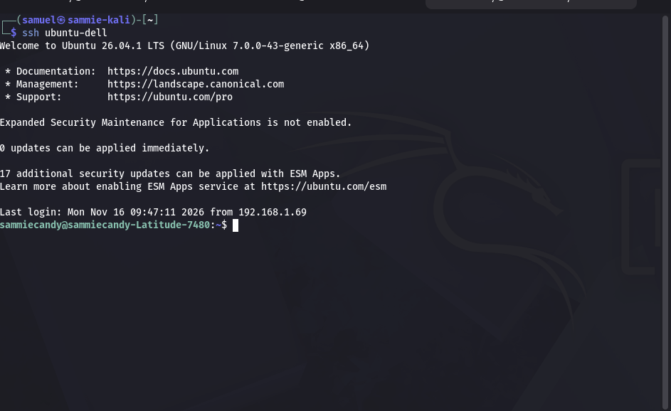
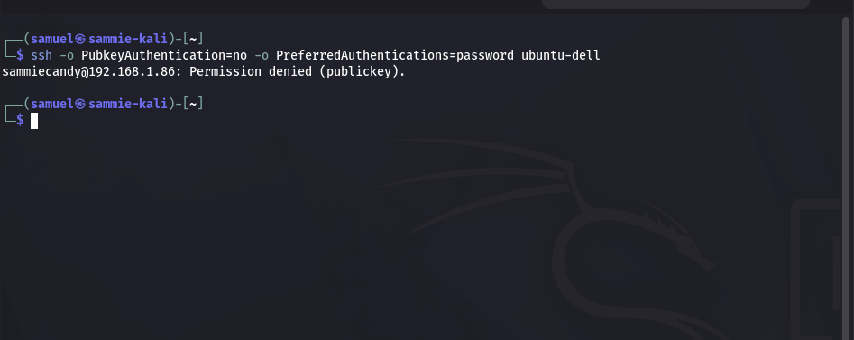
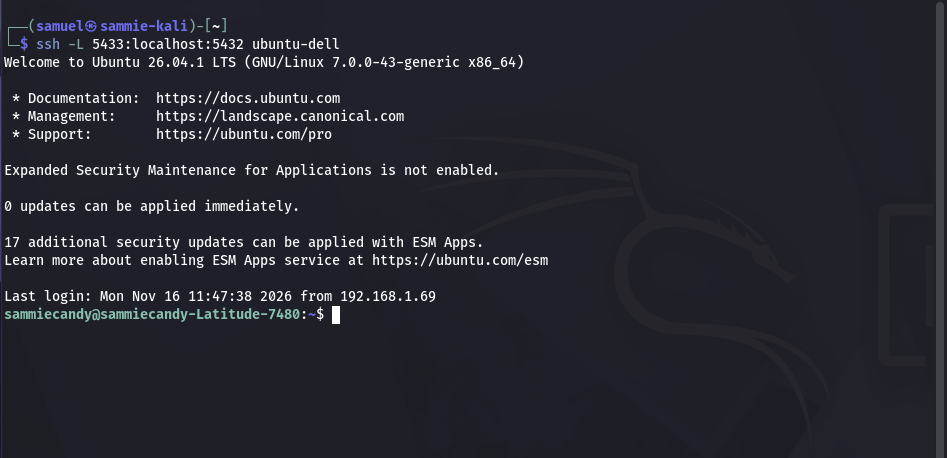
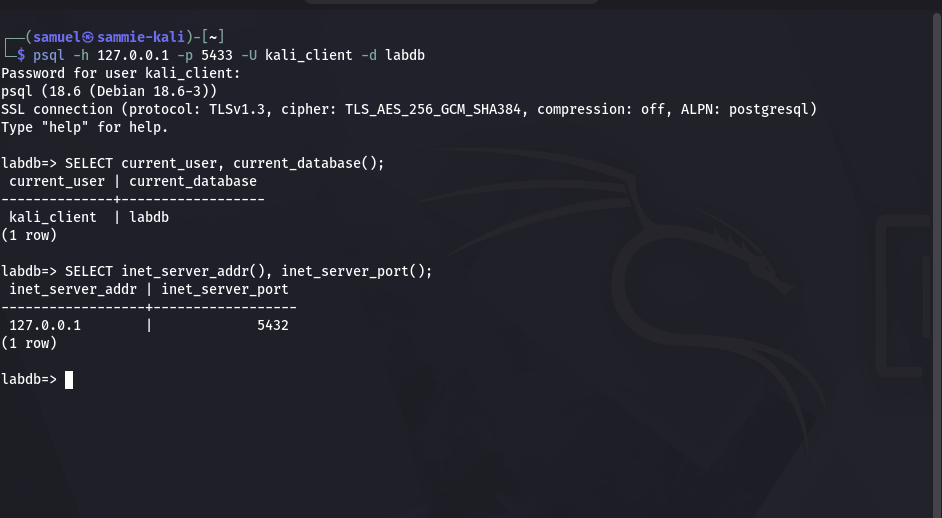
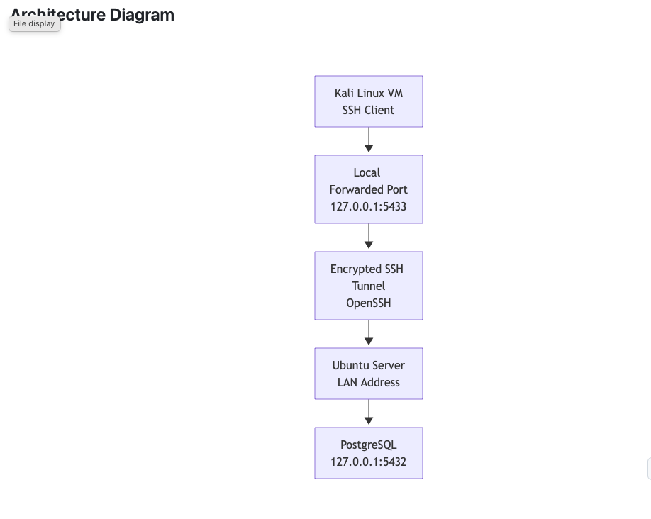

# Secure Linux Administration & Remote PostgreSQL Access

A hands-on infrastructure and security lab demonstrating Linux administration, SSH hardening, secure file transfers, SSH tunnelling, and remote PostgreSQL database management.

## Project Overview

This project involved configuring two separate Linux systems to establish secure remote administration and database connectivity.

The lab consists of:

- **Kali Linux:** SSH client running in a virtual machine on UTM.
- **Ubuntu:** Remote SSH server and PostgreSQL database host running on a Dell Latitude laptop.

The primary objective was to establish secure communication between the systems, strengthen SSH authentication, and access a remote PostgreSQL database through an encrypted SSH tunnel without exposing the database port directly to the network.


## Project Screenshots

### 1. SSH Key-Based Authentication
Successful remote access to Ubuntu using Ed25519 public-key authentication.



### 2. SSH Password Authentication Disabled
Verification that password-based SSH authentication is rejected.



### 3. SSH Tunnelling
Establishing an encrypted SSH tunnel from Kali Linux to Ubuntu.



### 4. Remote PostgreSQL Connection
Verifying the authenticated database connection through the SSH tunnel.



### 5. PostgreSQL Queries
Retrieving employee records and filtering results using SQL.


### 6. Network Architecture
Visual representation of the Kali Linux, SSH tunnel, Ubuntu, and PostgreSQL architecture.



## Technologies & Tools

| Category | Technologies |
|---|---|
| Operating Systems | Kali Linux, Ubuntu |
| Remote Administration | OpenSSH, SSH |
| Authentication | Ed25519 public-key authentication |
| File Transfers | SCP, SFTP |
| Networking | SSH local port forwarding, TCP |
| Database | PostgreSQL, SQL |
| Database Client | PostgreSQL command-line client |
| Virtualization | UTM |

## Network Architecture

The architecture uses SSH local port forwarding to securely connect the PostgreSQL client on Kali Linux to the PostgreSQL server on Ubuntu.

See [Network Architecture](docs/architecture.md) for the connection diagram and configuration details.

### Connection Flow

1. Kali Linux initiates an SSH connection to the Ubuntu server.
2. SSH establishes an encrypted connection.
3. Local port `5433` on Kali is forwarded to port `5432` on Ubuntu.
4. PostgreSQL accepts the connection through its local loopback interface.
5. Database authentication is performed using the PostgreSQL role `kali_client`.

PostgreSQL listens on `127.0.0.1:5432` on Ubuntu rather than being directly exposed to the LAN.

## Implementation & Key Achievements

### 1. SSH Configuration and Security Hardening

- Generated an Ed25519 SSH key pair on Kali Linux.
- Configured public-key authentication between Kali Linux and Ubuntu.
- Installed and configured the OpenSSH server on Ubuntu.
- Disabled password-based SSH authentication.
- Disabled keyboard-interactive authentication.
- Validated SSH configuration using `sshd -t` and inspected effective settings using `sshd -T`.
- Tested successful key-based authentication and verified that password-only authentication was rejected.

### 2. Secure Remote File Management

- Transferred files between systems using SCP.
- Established interactive SFTP sessions.
- Practised remote directory navigation and management.
- Uploaded, downloaded, renamed, and removed files and directories.

### 3. SSH Tunnelling and Remote Database Connectivity

- Installed and configured PostgreSQL on Ubuntu.
- Created a dedicated PostgreSQL login role and database.
- Verified PostgreSQL was listening on the local loopback interface (127.0.0.1:5432), rather than being directly exposed to the network.
- Established an SSH local port-forwarding tunnel from Kali Linux to Ubuntu.
- Installed the PostgreSQL client on Kali Linux.
- Connected to the remote PostgreSQL database through the SSH tunnel.
- Verified the database connection and server-side address using SQL queries.

### 4. PostgreSQL Database Administration

- Created database roles and assigned database ownership.
- Created relational tables using primary keys, data types, and constraints.
- Inserted and retrieved records using SQL.
- Filtered records using `WHERE` clauses.
- Updated and deleted records.
- Practised transaction management using `BEGIN`, `COMMIT`, and `ROLLBACK`.

## SQL Exercises

The `sql/` directory contains scripts demonstrating database setup and common SQL operations.

| File | Description |
|---|---|
| `01-create-database.sql` | Creates the database login role and database |
| `02-create-tables.sql` | Creates the employees table |
| `03-sample-data.sql` | Inserts sample employee records |
| `04-crud-operations.sql` | Demonstrates SQL CRUD operations |

## Repository Structure

```text
secure-linux-postgresql-lab/
│
├── configs/
│   └── sshd_config.example
│
├── docs/
│   └── architecture.md
│
├── screenshots/
│
├── sql/
│   ├── 01-create-database.sql
│   ├── 02-create-tables.sql
│   ├── 03-sample-data.sql
│   └── 04-crud-operations.sql
│
├── .gitignore
└── README.md
```

## Reproducing the Lab

### Prerequisites

- Two Linux systems or virtual machines.
- OpenSSH client on the Kali machine.
- OpenSSH server on the Ubuntu machine.
- PostgreSQL server on Ubuntu.
- PostgreSQL command-line client on Kali.
- Network connectivity between the two systems.

### 1. Configure SSH Access

Generate an Ed25519 key pair on the Kali client:

```bash
ssh-keygen -t ed25519 -C "kali-to-ubuntu"
```

Copy the public key to Ubuntu:

```bash
ssh-copy-id username@UBUNTU_LAN_IP
```
UBUNTU_LAN_IP was ubuntu-dell for me (alias for the IP)

Configure the SSH server to allow public-key authentication and disable password-based authentication.

An example of the relevant settings is available in:

`configs/sshd_config.example`

Validate the configuration before reloading SSH:

```bash
sudo sshd -t
sudo systemctl reload ssh
```


### 2. Configure PostgreSQL on Ubuntu

Install PostgreSQL:

```bash
sudo apt update
sudo apt install postgresql
```

The SQL setup scripts are located in the `sql/` directory. Transfer the repository files to Ubuntu before running them.

Open a PostgreSQL administrative session:

```bash
sudo -u postgres psql
```

Execute the database setup script from the repository root:

```sql
\i sql/01-create-database.sql
```

Set the password for the dedicated database login interactively:

```sql
\password kali_client
```

Exit the administrative session:

```sql
\q
```

The setup script creates the `kali_client` login role and the `labdb` database, assigning database ownership to `kali_client`.

Create the employees table and insert sample records:

```bash
psql -h 127.0.0.1 -U kali_client -d labdb -f sql/02-create-tables.sql

psql -h 127.0.0.1 -U kali_client -d labdb -f sql/03-sample-data.sql
```

Enter the `kali_client` password when prompted.

Verify that PostgreSQL is listening on the local loopback interface:

```bash
sudo ss -lntp | grep 5432
```

Expected listening address:

```text
127.0.0.1:5432
```

### 3. Establish the SSH Tunnel

From Kali Linux:

```bash
ssh -L 5433:localhost:5432 username@UBUNTU_LAN_IP
```

Keep the SSH session open while using the tunnel.

### 4. Connect to PostgreSQL

Open another terminal on Kali Linux:

```bash
psql -h 127.0.0.1 -p 5433 -U kali_client -d labdb
```

Enter the PostgreSQL role password when prompted.

## Security Considerations

- SSH public-key authentication was used for remote access.
- Password-based SSH authentication was disabled.
- SSH traffic was encrypted.
- PostgreSQL was verified to be listening on the Ubuntu loopback interface only.
- PostgreSQL credentials were kept separate from SSH credentials.
- Private keys and passwords should never be committed to the repository.

See `configs/sshd_config.example` for the documented SSH authentication settings.

## Skills Demonstrated

- Linux system administration
- SSH configuration and hardening
- Public-key authentication
- Secure remote file transfers
- SSH local port forwarding
- Network connectivity troubleshooting
- PostgreSQL installation and administration
- SQL CRUD operations
- Database roles and access management
- Transaction management

## Learning Outcomes

Developed practical experience administering separate Linux systems, securing remote access, troubleshooting network connectivity, and managing a PostgreSQL database through an encrypted SSH tunnel.

This project strengthened my understanding of the relationship between operating systems, networking, authentication, and database security.
