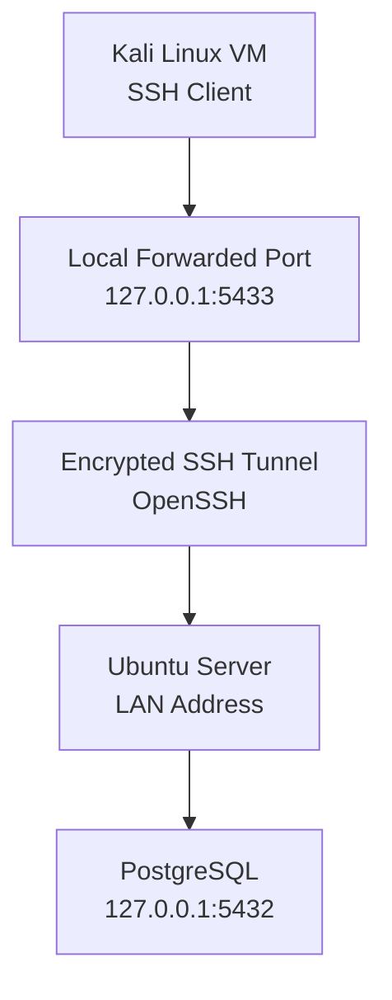

# Lab Network Architecture

## Overview

This lab uses two separate Linux systems to demonstrate secure remote administration and PostgreSQL database connectivity.

## Architecture Diagram



## Connection Details

| Component | Configuration |
|---|---|
| SSH client | Kali Linux |
| SSH server | Ubuntu |
| SSH server address | Ubuntu LAN IP address |
| SSH port | 22 |
| Local forwarded address | 127.0.0.1:5433 |
| PostgreSQL address | 127.0.0.1 |
| PostgreSQL port | 5432 |
| Database | labdb |
| Database user | kali_client |

## SSH Port Forwarding

The following command establishes the tunnel from Kali Linux:

```bash
ssh -L 5433:localhost:5432 ubuntu-dell
```

This forwards connections made to Kali's local port 5433 through SSH to PostgreSQL's local port 5432 on Ubuntu.

PostgreSQL was verified to be listening on the Ubuntu loopback interface at 127.0.0.1:5432, rather than being directly exposed to the network.

The SSH tunnel provides the secure communication path between the two systems.

## Security Design

- SSH public-key authentication is used for remote access.
- Password-based SSH authentication is disabled.
- Keyboard-interactive SSH authentication is disabled.
- SSH traffic is encrypted.
- PostgreSQL listens on the Ubuntu loopback interface only.
- Database authentication is handled separately from SSH authentication.
- PostgreSQL credentials and SSH private keys are kept separate.
